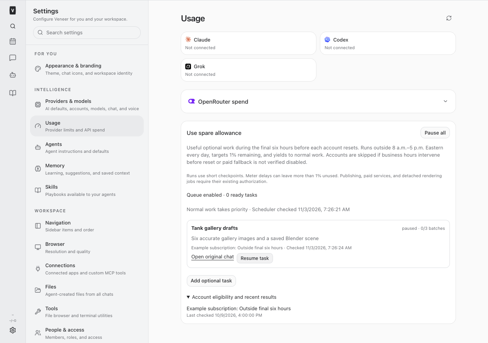
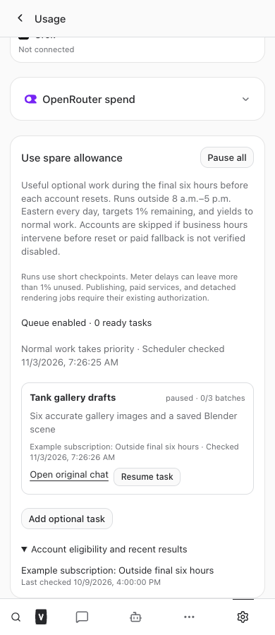
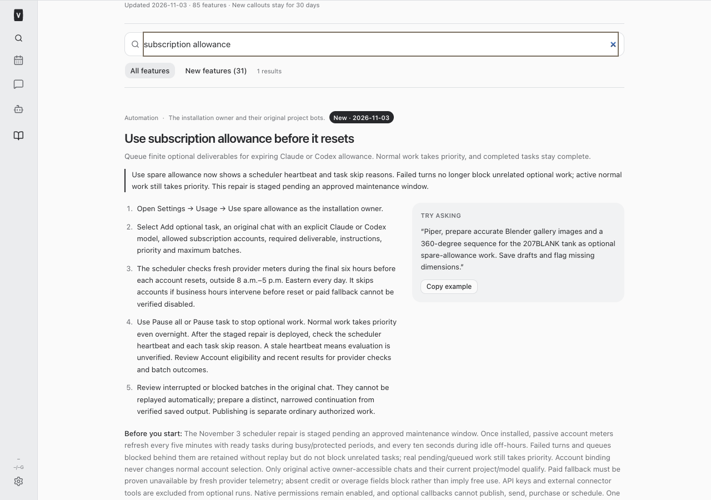
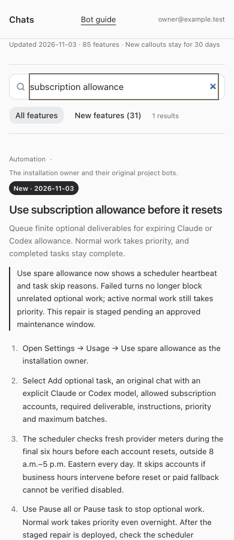

# Spare-allowance starvation repair — build 968

November 3, 2026. Staged repair; production deployment and live optional-task completion
are not claimed. The original October release enrolled Piper's task but never started
a run or recorded an account evaluation.

## Confirmed cause

`normalWorkWaiting` checked all rows in `pending_turns`, including status `failed`.
A failed Lippert turn, conversation `79fd0a41-d395-4901-a9c8-24f0e1b446c7`, has remained
there since October 12 at 13:15 UTC. Its presence alone made the global blocker true
continuously. Failed attempts are retained for recovery/reconciliation; they are not
active compute. The scheduler also returned before telemetry and status persistence
whenever normal work or protected hours blocked dispatch. That hid the starvation
behind empty account/run history.

The live runner's built entry point includes `spare.start()`. Piper's original task
`0ecf3a0c-1954-45e6-a147-2cea2d4d0d35` remains ready; current original chat/model/access
checks pass. The current live database also contains genuine pending/queued work;
that remains a valid temporary blocker after this repair. No business recovery or
failed source attempt was cleared or retried.

## Repair

Only status `pending` now counts in the pending-turn blocker. Queues blocked behind
a retained failed turn do not globally starve other chats; that chat itself remains
failed/ineligible. Real pending/queued normal work still blocks optional dispatch
and preempts a running optional batch.

Migration 0195 adds a durable scheduler heartbeat and per-task checked time/skip
reason. Settings → Usage shows the last scheduler check, reports staleness after
90 seconds, and shows task/account skip reasons. Missing heartbeat is explicitly
unverified evaluation, not success. A heartbeat records protected hours, normal
work, pause, no tasks, provider-read failure and dispatch state. It refreshes at
least every 30 seconds while the runner is ticking.

With ready tasks and an enabled queue, passive provider reads continue at most once
per five minutes while busy or during protected hours. Idle off-hours retain the
ten-second meter cadence and refresh between bounded checkpoints. All dispatch
gates are checked again after asynchronous reads, including disable. Empty or
failed account reads produce a concrete skip; no eligibility is fabricated.

Final-six-hour, every-day 8–5 Eastern, all-window, exact-account, reserve, no paid
fallback, no fresh-cycle spill and permanent UNKNOWN/no-replay rules are unchanged.
The fix neither removes failed attempts nor retries their retained queues.

## Genuine account check

The existing native `account/rateLimits/read` path was used once for the approved
`drmark@mphealth.net` account, with its exact profile. It reported live data, plan
`prolite`, paid fallback unavailable, weekly usage 0%, next reset November 10 at
12:24:43 UTC (7:24:43 a.m. Eastern). It was outside the final six hours. This
read-only check generated no model turn and changed no global selected account.

[Sanitized native meter observation](./account-check.json). This is an observation
at the recorded time, not future eligibility. The real Piper task was not forced
to run outside its authorized window, and no production telemetry rows or cycles
were manufactured. No render, installation, publication, purchase or paid API use
was performed.

## Validation

Focused checks passed: 55 tests across scheduler/runtime, HTTP scope and guide
contracts. A real ConversationManager with a controlled adapter drives durable
reservation → pinned-account TurnSpec → immutable checkpoint → successful completion
→ terminal task, despite an unrelated retained failure; a subsequent tick cannot
repeat it. Separate cases prove real normal work preempts, failed queues stay
intact, business-hour passive reads cannot dispatch, heartbeat persists, missing
accounts/provider failure skip, and disable during a provider read wins. Existing
DST/window/reserve/restart/permission/no-replay and account-pinning regressions remain.

Desktop/mobile isolated browser checks passed backlog enrollment, account choice,
global/task pause, heartbeat, task skip reason, account history, overflow and full/
restricted employee guide discovery. Every API request was mocked; no customer or
production task data was used. Screenshots were visually inspected. Fresh/resumed
agent instruction tests retain current tools and authorization limits; the guide
announcement labels the repair staged pending maintenance.

Root `npm run typecheck`, one final full `npm test`, and root `npm run build` all
passed serially under the host-wide development lock with the configured single
Vitest worker. Final totals: 3,305 server tests passed (17 skipped), 1,040 web tests,
96 installer tests and 62 browser-manager tests passed. `git diff --check` passed.
The production build emitted the existing large-chunk advisory; no check failed. No production restart is authorized
by this build request. Repository AGENTS.md requires an explicit maintenance
window, draining active turns and restarting affected services only. Expected
affected services are web (migration/API/UI/guide) and runner (scheduler).

## Changed files

- [docs/bot-feature-guide.md](/Users/archerclawdington/veneer-os/docs/bot-feature-guide.md)
- [docs/reports/spare-allowance/build968/account-check.json](/Users/archerclawdington/veneer-os/docs/reports/spare-allowance/build968/account-check.json)
- [docs/reports/spare-allowance/build968/desktop.png](/Users/archerclawdington/veneer-os/docs/reports/spare-allowance/build968/desktop.png)
- [docs/reports/spare-allowance/build968/guide-desktop.png](/Users/archerclawdington/veneer-os/docs/reports/spare-allowance/build968/guide-desktop.png)
- [docs/reports/spare-allowance/build968/guide-mobile.png](/Users/archerclawdington/veneer-os/docs/reports/spare-allowance/build968/guide-mobile.png)
- [docs/reports/spare-allowance/build968/mobile.png](/Users/archerclawdington/veneer-os/docs/reports/spare-allowance/build968/mobile.png)
- [docs/reports/spare-allowance/build968/report.md](/Users/archerclawdington/veneer-os/docs/reports/spare-allowance/build968/report.md)
- [scripts/spare-allowance-browser-check.mjs](/Users/archerclawdington/veneer-os/scripts/spare-allowance-browser-check.mjs)
- [server/src/db/migrations/0195_spare_scheduler_status.sql](/Users/archerclawdington/veneer-os/server/src/db/migrations/0195_spare_scheduler_status.sql)
- [server/src/featureGuide/catalog.ts](/Users/archerclawdington/veneer-os/server/src/featureGuide/catalog.ts)
- [server/src/spareAllowance/routes.ts](/Users/archerclawdington/veneer-os/server/src/spareAllowance/routes.ts)
- [server/src/spareAllowance/scheduler.ts](/Users/archerclawdington/veneer-os/server/src/spareAllowance/scheduler.ts)
- [server/test/spareAllowance.test.ts](/Users/archerclawdington/veneer-os/server/test/spareAllowance.test.ts)
- [server/test/spareAllowanceRoutes.test.ts](/Users/archerclawdington/veneer-os/server/test/spareAllowanceRoutes.test.ts)
- [web/src/screens/settings/SpareAllowancePanel.tsx](/Users/archerclawdington/veneer-os/web/src/screens/settings/SpareAllowancePanel.tsx)

## Deployment handoff

The repair is committed and pushed to origin main; code/build checks are complete.
No restart or migration was applied to the running production services in this turn.
[Repository guidance](/Users/archerclawdington/veneer-os/AGENTS.md) requires:
“Do not restart production as the automatic last step of a build.” It requires an
explicit human-approved maintenance window and no active turns before a restart.
After approval, deploy only web and runner using the sanctioned root restart command
with `--maintenance-approved`; do not force, signal services directly, or use a
detached watcher if work cannot drain. Preserve all active business work.

Post-deployment verification must read the new scheduler heartbeat, verify the
retained failed turn no longer globally blocks it, and check genuine account skip
reasons. A real completed task still requires a genuinely eligible account/time
and normal-work idle interval. An external effect, UNKNOWN batch, stale meter or
missing paid-fallback proof must not be retried or represented as success.
Until that production verification exists, this thread is not marked ready to archive.

## Production readback — November 5, 2026

Nick approved web/runner deployment after normal work drains. Before restarting,
readbacks showed the repair already running: migration 0195's status table exists,
the scheduler heartbeat is current, and genuine provider snapshots are updating.
No redundant restart was performed and no active turns were interrupted. The exact
intervening deployment event was not independently attributed in this check.

At 12:29 UTC, scheduler state was “Normal work takes priority”; account evaluation
was recorded at 12:25:05 UTC. The approved drmark Codex account reported live usage
40%, paid fallback disabled, and weekly reset November 10 at 22:27:58 UTC
(5:27:58 p.m. Eastern). It is currently outside the final six hours. Under the
every-day protected-hours policy, its first potential dispatch interval is only
after 5 p.m. on November 10, before the reset cutoff, if normal work is idle and
fresh telemetry/access still pass. Changed provider reset times remain authoritative.
Other accounts record specific paid-fallback or outside-window reasons; the Piper
task remains restricted to its approved drmark account.

Local web/runner health passed; public front door returned HTTP 302 and the tunnel
had four connections. These health checks do not establish authenticated browser
chat delivery. Authenticated native backlog readback was checked separately.
No optional run is recorded yet. The starvation/observability repair is verified
live; actual model execution and checkpoint completion remain to be verified in a
genuinely eligible window. A follow-up will check that window rather than fabricate
usage/time, widen accounts, or force a task through normal work.
